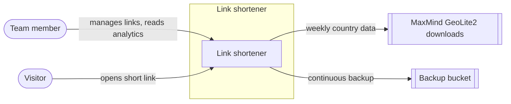

<!-- Generated from docs/design/link-shortener/ on 2026-10-25 by the tech-design publish skill. Edit the design and republish; changes here are overwritten. -->

# Self-hosted link shortener: summary

**Goal.** Give the team short, memorable links (`go.example.com/<code>`) and show how often each one is used, while keeping visitor data on our own server.

**Approach.** A small app runs on our existing VPS. Team members log in to create links and see per-link charts: clicks per day, where visitors came from, and which countries they're in. Visitors are redirected instantly. The app records only anonymous counts, never IP addresses. The database is backed up continuously to off-site storage.

**Top risks.**

- Server failure loses data. Mitigated by continuous off-site backup that can be restored in minutes, though the restore isn't tested on a schedule.
- Short links used to disguise harmful sites. Mitigated: only team members can create links, every link records who made it, and any link can be disabled.
- Analytics slightly undercount, for example around a crash or for bot traffic, which is excluded. Accepted: the numbers show trends and aren't used for billing.

**Cost and effort.** Running cost is the existing VPS plus free tiers (MaxMind GeoLite2, backup storage). Build effort isn't estimated.

**Engineering detail:** [Self-hosted link shortener](link-shortener.md)
