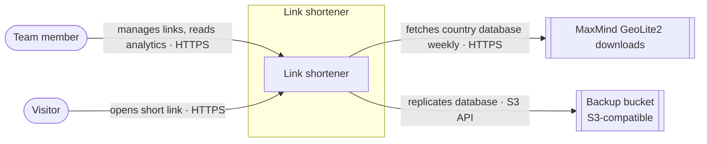
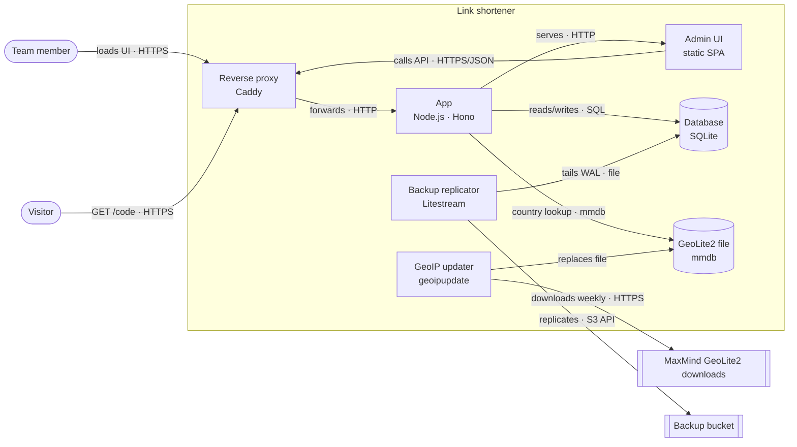
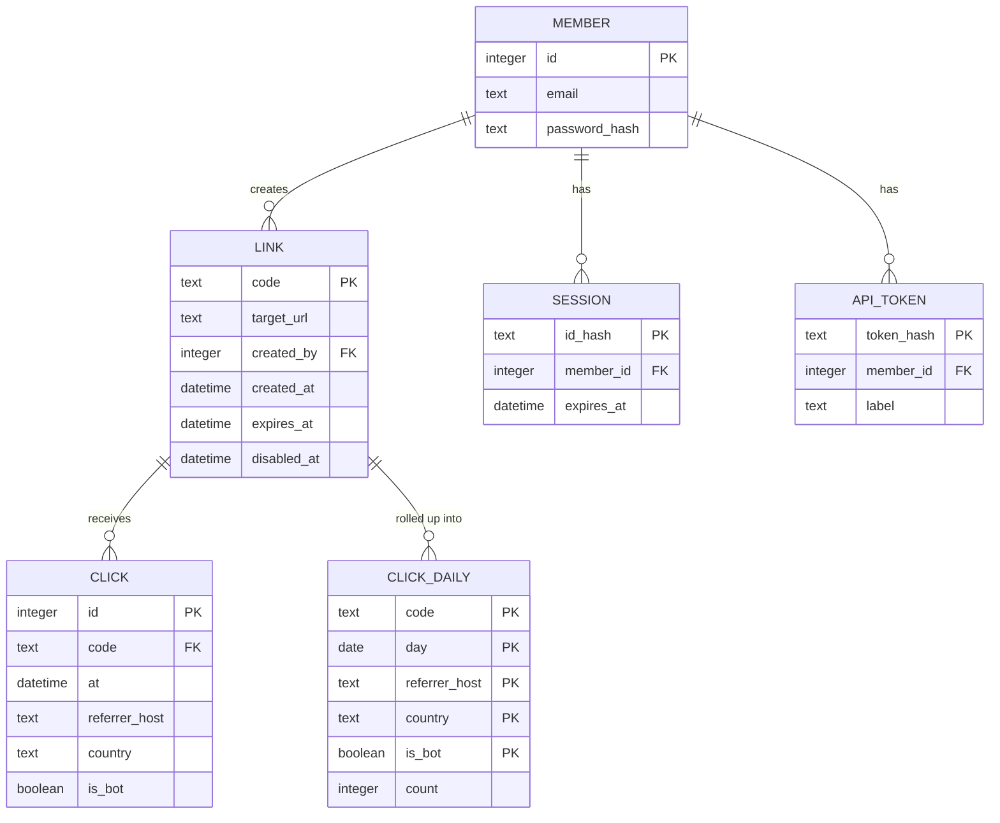
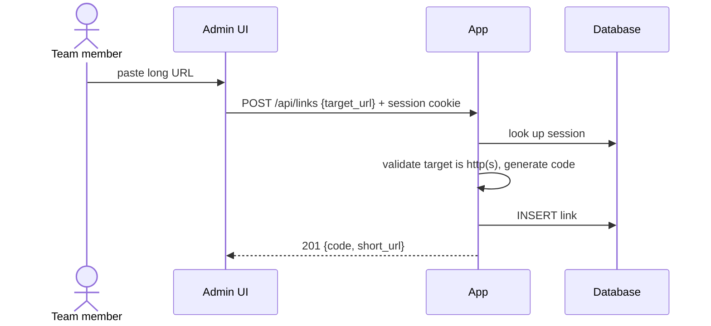
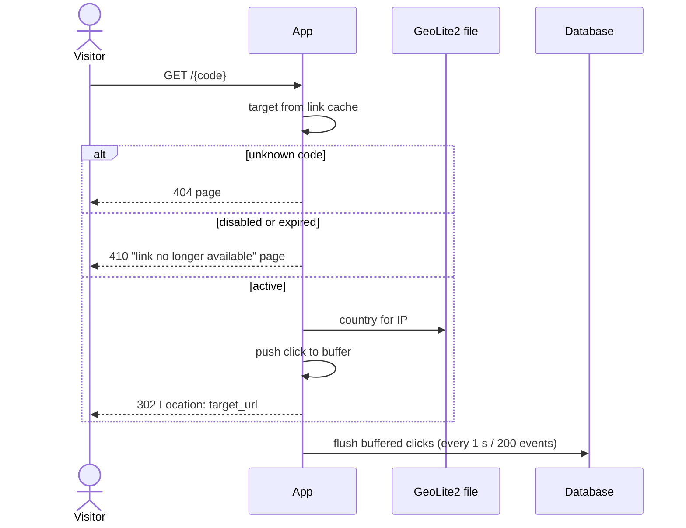
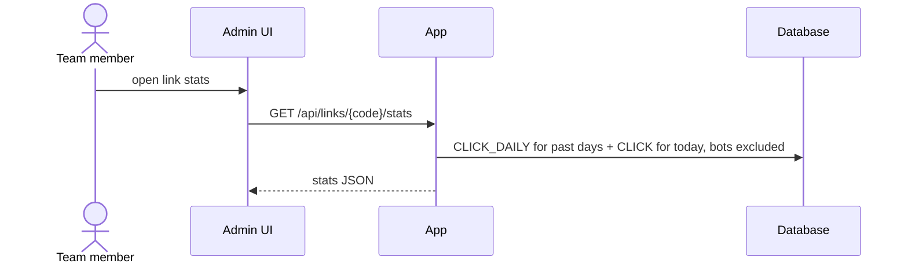

<!-- Generated from docs/design/link-shortener/ on 2026-10-25 by the tech-design publish skill. Edit the design and republish; changes here are overwritten. -->

# Self-hosted link shortener

> A team link shortener on our own VPS that turns long URLs into `go.example.com/<code>` links and shows how each one is used, without sending visitor data to anyone else.

## Overview

The team shares many long URLs and wants short, memorable links plus a sense of which ones get used. Hosted shorteners would send every visitor's IP and browser data to a third party, so we run our own.

The system is one small Node.js app behind Caddy, storing everything in a single SQLite file on one VPS. Redirects come from an in-memory cache and click recording happens off the request path, so redirects stay fast. Analytics are derived at capture time with no personal data stored, and the database streams continuously to an off-host bucket.

**Success criteria**

- A team member creates a short link from the web UI or the API in under 1 s.
- Visiting a short link redirects with server-side latency p95 < 50 ms at 50 req/s.
- Per-link analytics show clicks per day, top referrers and top countries.
- The whole system runs on one 2 vCPU / 4 GB VPS with `docker compose up`.

**Out of scope:** public sign-up or multi-tenant use, per-user custom domains, link-in-bio pages, real-time dashboards, QR codes.

**Constraints:** one VPS (2 vCPU, 4 GB), Docker Compose, one maintainer, TypeScript on Node.js, no paid services. Expected scale is ~1k links, ~100k redirects a month and peaks of 50 req/s.

## System context

- **Team member**: creates and manages links, reads analytics.
- **Visitor**: anyone opening a short link. Visitors never log in.
- **MaxMind GeoLite2 downloads**: a free IP-to-country database, fetched weekly and queried locally.
- **Backup bucket**: off-host copy of the database. Only used for backup and restore; serving traffic doesn't depend on it.

## Architecture

| Component | Responsibility | Tech |
| --- | --- | --- |
| Reverse proxy | TLS termination, HTTP→HTTPS, forwards everything to the App | Caddy |
| App | Redirects from an in-memory link cache, link and analytics APIs, member auth, click buffer, nightly rollup, admin UI hosting, member CLI | Node.js, Hono |
| Admin UI | Create, edit, disable and re-enable links; view analytics | Static SPA served by the App |
| Database | Members, sessions, API tokens, links, clicks and daily rollups | SQLite (WAL) on the `app_data` volume |
| GeoLite2 file | IP-to-country lookups. The App reloads it when it changes (checked hourly). | MaxMind mmdb on `app_data` |
| GeoIP updater | Refreshes the GeoLite2 file weekly | `maxmind/geoipupdate` |
| Backup replicator | Continuous off-host replication of the database | Litestream |

One App process does everything. That's deliberate at this scale: SQLite allows one writer, and the click buffer and login rate limiter both live in that process's memory.

## Data

| Entity | Notes |
| --- | --- |
| Member | A handful of rows. Passwords are hashed with argon2id. Members are created through the CLI only. |
| Session | Opaque ID stored hashed, 30-day sliding expiry. |
| API token | Shown once at creation, stored as a SHA-256 hash. |
| Link | ~1k rows. Code is either 7 random base62 chars or a custom code. Optional expiry; members can disable a link. |
| Click | Raw events, ~100k a month, kept 90 days. Has no IP or user agent. |
| Click daily | Per-day aggregates by referrer host, country and bot flag, kept indefinitely. |

All entities are owned by the App and stored in the one SQLite database.

## How it works

### Creating a link

A member pastes a URL into the Admin UI, which calls `POST /api/links` with the session cookie. The App checks the session and rejects any target that isn't `http(s)`. It then takes the custom code if one was given, or generates one, retrying on the rare collision, and inserts the link. This is one indexed lookup and one insert, far inside the 1 s budget.

### Following a link

Every redirect is answered from memory. The App resolves the code from its link cache, which is invalidated on every edit.

- **Unknown codes** get a 404 page.
- **Disabled or expired links** get a 410 "no longer available" page.
- **Active links** get a `302` with caching disabled, so every click reaches the server.

For active links, the App resolves the visitor's IP to a country and their user agent to a bot flag, keeps only the referrer's host, then drops the IP and user agent. The resulting click event goes into an in-memory buffer, which is flushed to SQLite in a single transaction every second or every 200 events. The redirect never waits on the database.

### Viewing analytics

Every night a rollup job inside the App aggregates the previous UTC day into `CLICK_DAILY`, then deletes raw clicks older than 90 days. The job upserts whole days, so re-running it is safe. A stats request reads rollups for complete days plus raw clicks for today and merges the two. Each query is scoped to one link. Bot traffic is excluded unless `bots=true` is passed.

## Deployment

A single `docker-compose.yml` runs the whole system, and `docker compose up -d` brings it up.

| Service | Image | Volumes | Notes |
| --- | --- | --- | --- |
| `caddy` | `caddy:2` | `caddy_data` | Ports 80/443; automatic TLS for `BASE_URL` |
| `app` | built from the repo | `app_data:/data` | Healthcheck `GET /healthz`; `restart: unless-stopped` |
| `geoipupdate` | `maxmind/geoipupdate` | `app_data:/data` | Weekly refresh |
| `litestream` | `litestream/litestream` | `app_data:/data` | Replicates `/data/shortener.db` to the bucket |

- **Config and secrets** live in an uncommitted `.env` file: `BASE_URL`, the MaxMind account ID and licence key, and the bucket name and credentials.
- **First boot:** until the first GeoLite2 download lands, clicks are stored with country `unknown`.
- **Restore:** stop `app`, run `litestream restore -o /data/shortener.db <bucket path>` in a one-off container, then start `app`. Recovery point is about one second; recovery time is minutes.
- **Upgrade:** `docker compose pull && docker compose up -d app`. Schema migrations run at App start, inside a transaction.

## Access control

- `GET /{code}` is public. Everything under `/api/*` and `/admin/*` needs a member session or an API token.
- Members are managed with `app member add|remove|reset <email>`. There's no sign-up, so the public can never create links.
- Browser sessions use `HttpOnly; Secure; SameSite=Lax` cookies. Mutating API calls must send `Content-Type: application/json`, which together block cross-site form posts.
- Scripts authenticate with `Authorization: Bearer <token>`.
- Login is limited to 5 failures per 15 minutes per email and IP.
- Every link records its creator, so an abusive link can be traced and disabled.

## Key decisions

| Decision | Choice | Why | Record |
| --- | --- | --- | --- |
| Primary store | SQLite, single node | One file to run and back up; ample for the load | [ADR 0001](../design/link-shortener/decisions/0001-sqlite-as-the-only-store.md) |
| Code format | 7 random base62 chars | 3.5 × 10¹² codes against ~1k links; retry on collision | — |
| Process layout | One App process | Matches SQLite's single writer; split only if redirects need it | — |
| Geo lookup | Local GeoLite2 file | Visitor IPs never leave the server | — |
| Redirect status | `302`, not cacheable | Every click is counted and edits apply immediately | [ADR 0002](../design/link-shortener/decisions/0002-redirect-with-302.md) |
| Click write path | In-memory buffer, batched flush | Redirect latency is independent of disk writes | [ADR 0003](../design/link-shortener/decisions/0003-buffer-click-writes.md) |
| Visitor data | No IP or UA stored; raw 90 days, rollups forever | No personal data held; bounded growth | [ADR 0004](../design/link-shortener/decisions/0004-click-retention.md) |
| Member auth | Built-in accounts, session cookies, hashed API tokens | Per-member attribution and revocation without an identity provider | [ADR 0005](../design/link-shortener/decisions/0005-built-in-accounts.md) |
| Backups | Litestream to a free-tier S3-compatible bucket | Off-host, ~1 s recovery point, one tool | [ADR 0006](../design/link-shortener/decisions/0006-litestream-backups.md) |
| GeoIP refresh | `geoipupdate` sidecar, hot reload | Current data with no restarts | — |
| Custom codes | Optional, 3–32 chars of `a-z0-9-` | Memorable links; `api`, `admin`, `login`, `healthz` reserved | — |
| Link lifecycle | Optional expiry, disable/re-enable | Unknown → 404, disabled/expired → 410; no click recorded | — |

## Known limitations

- **Single node.** One App instance and one SQLite writer. Scaling out means moving to a server database.
- **Clicks can be lost.** A crash loses up to about one second of buffered clicks, so analytics are indicative, not billing-grade.
- **No unique visitors.** Visitors can't be counted uniquely because no visitor identifiers are stored. Stats older than 90 days are per-day only.
- **Missed rollups aren't caught up.** If the App is down at rollup time, that day isn't rolled up, and its raw clicks expire after 90 days.
- **Unknown countries.** Country is `unknown` for private IPs and whenever the GeoLite2 file is missing.
- **Untested restore.** The restore procedure isn't exercised on a schedule.
- **Public health check.** `/healthz` is reachable through the proxy and returns only a liveness response.
