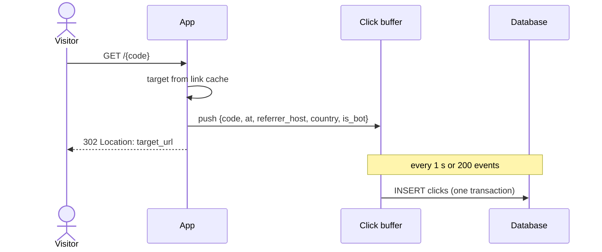
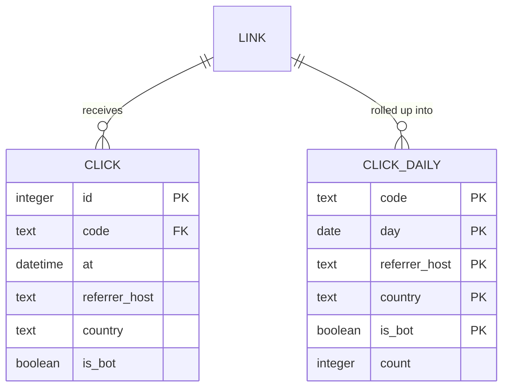

# Analytics: Self-hosted link shortener

Part of [Self-hosted link shortener](../design.md). Summary there; detail here.

## Scope

How a redirect becomes a click record, what is stored about visitors, how long, and how stats are queried. Starts at the redirect handler in the App and ends at the stats API; the Admin UI only renders what the API returns.

## Click capture

The redirect handler never waits on the database for clicks:

1. Look up the target (links are cached in memory; ~1k rows, invalidated on edit).
2. Build a click event in memory: `code`, `at`, referrer **host** only, country from GeoLite2, `is_bot` from the user agent (`isbot` library).
3. Push it to the **click buffer** and respond `302` immediately.
4. The buffer flushes in a single transaction every 1 s or every 200 events, whichever comes first, and on graceful shutdown.

The IP and full user agent are used in memory to derive country and `is_bot`, then dropped. They are never written.

## Storage and retention

- `CLICK` holds raw events for **90 days**: ~300k rows at the expected volume.
- `CLICK_DAILY` holds per-day aggregates **indefinitely**.
- A nightly **rollup job** inside the App aggregates the previous UTC day into `CLICK_DAILY`, then deletes raw rows older than 90 days. The job is idempotent: it upserts a full day, so re-running is safe.

## Stats queries

`GET /api/links/{code}/stats?from&to&bots=false` reads `CLICK_DAILY` for complete days plus `CLICK` for today, then merges the two. Bots are excluded unless `bots=true`. Each query is bounded to one link, so it stays well under 50 ms at this volume.

## Related decisions

- [0002. Redirect with 302, never cached](../decisions/0002-redirect-with-302.md)
- [0003. Buffer click writes off the redirect path](../decisions/0003-buffer-click-writes.md)
- [0004. Store no IPs; keep raw clicks 90 days, rollups forever](../decisions/0004-click-retention.md)
