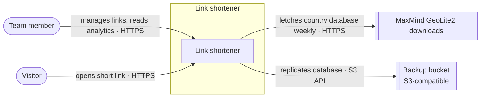
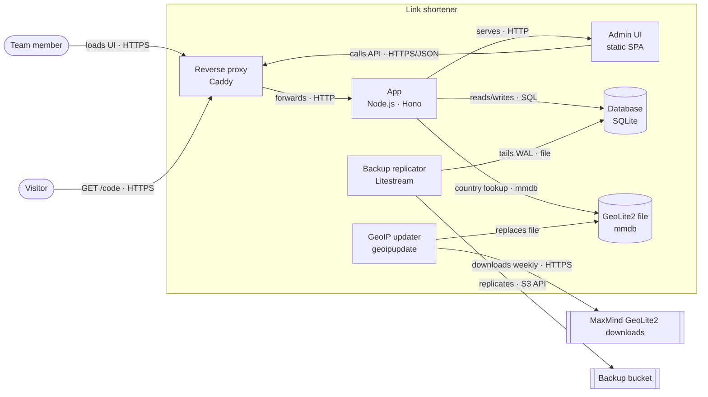
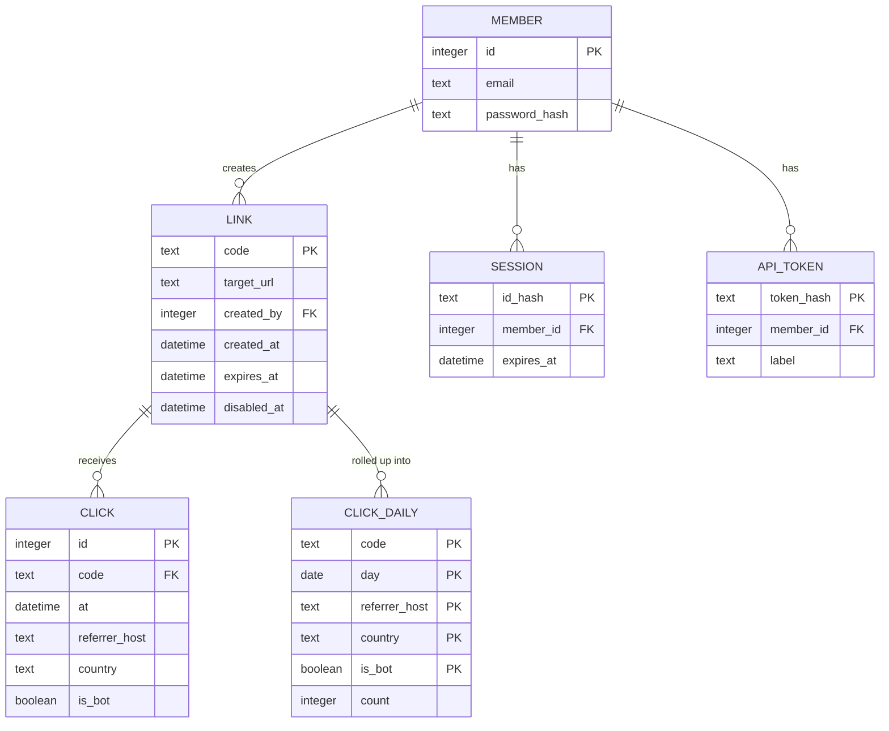
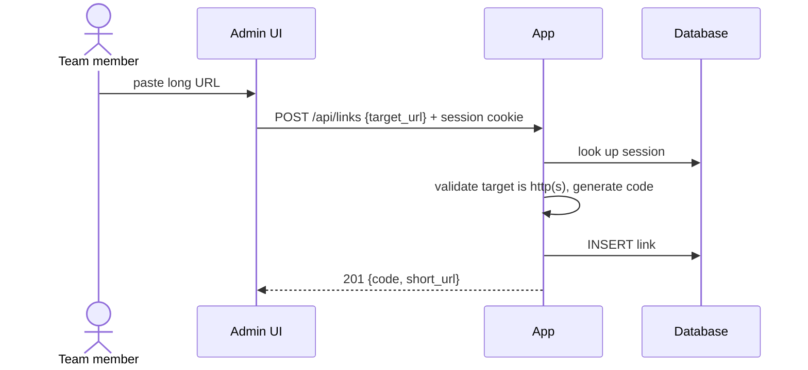
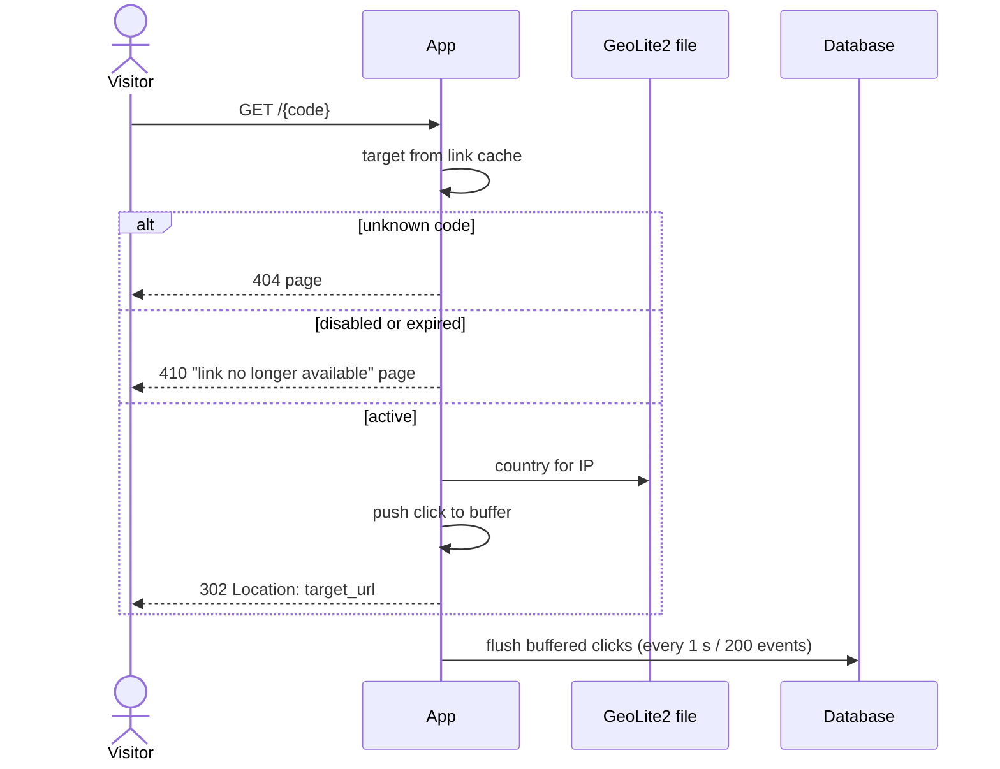
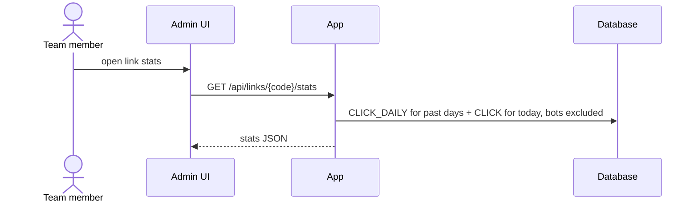

# Self-hosted link shortener

## Goal

A link shortener for a small team, self-hosted on our own VPS, that turns long URLs into short `go.example.com/<code>` links and shows how each link is used, without sending visitor data to a third party.

Success criteria:

- [ ] A team member creates a short link from the web UI or the API in under 1 s.
- [ ] Visiting a short link redirects with server-side latency p95 < 50 ms at 50 req/s.
- [ ] Per-link analytics show clicks per day, top referrers and top countries.
- [ ] The whole system runs on one 2 vCPU / 4 GB VPS with `docker compose up`.

## Non-goals and constraints

**Non-goals:** public sign-up / multi-tenant SaaS, per-user custom domains, link-in-bio pages, real-time dashboards, QR code generation.

**Constraints:**

- One VPS (2 vCPU, 4 GB RAM), Docker Compose, one maintainer.
- TypeScript on Node.js; no paid external services.
- Scale: ~1k links, ~100k redirects/month, peaks of 50 req/s.

## Context

- **Team member**: creates and manages links, reads analytics.
- **Visitor**: anyone opening a short link; never logs in.
- **MaxMind GeoLite2 downloads**: free IP-to-country database, fetched weekly and read locally, so no visitor data leaves the server.
- **Backup bucket**: off-host copy of the database (ADR 0006); only used for backup and restore.

## Components

| Component | Responsibility | Tech |
| --- | --- | --- |
| Reverse proxy | TLS termination, HTTP→HTTPS, forwards everything to the app | Caddy |
| App | Redirects (from an in-memory link cache), link CRUD API, analytics API, member auth, click buffer, nightly rollup job, serves the admin UI, member CLI | Node.js, Hono |
| Admin UI | Create, edit, disable and re-enable links; view analytics | Static SPA served by the app |
| Database | Members, sessions, API tokens, links, clicks and daily rollups | SQLite file (WAL) on the `app_data` volume |
| GeoLite2 file | IP-to-country lookups; the App reloads it when its mtime changes (checked hourly) | MaxMind mmdb on the `app_data` volume |
| GeoIP updater | Refreshes the GeoLite2 file weekly | `maxmind/geoipupdate` container |
| Backup replicator | Continuous off-host replication of the database | Litestream container |

## Data

| Entity | Owner | Store | Notes |
| --- | --- | --- | --- |
| Member | App | SQLite | Handful of rows; argon2id hash; created via CLI |
| Session | App | SQLite | Opaque ID, stored hashed; 30-day sliding expiry |
| API token | App | SQLite | Shown once, stored as SHA-256 hash |
| Link | App | SQLite | ~1k rows; generated or custom `code`; optional `expires_at`; `disabled_at` set by a member; cached in App memory |
| Click | App | SQLite | Raw events, ~100k/month, kept 90 days; no IP or user agent stored |
| Click daily | App | SQLite | Per-day aggregates, kept indefinitely |

Capture, retention and query detail: [areas/analytics.md](areas/analytics.md).

## Key flows

### Create a link

Proves: create a link in under 1 s.

### Follow a link

Proves: redirect p95 < 50 ms. The click write happens off the redirect path ([analytics](areas/analytics.md#click-capture)). Clicks are recorded only for active links.

### View analytics

Proves: clicks per day, top referrers, top countries.

## Deployment

One `docker-compose.yml` on the VPS. `docker compose up -d` brings up the whole system.

| Service | Image | Volumes | Notes |
| --- | --- | --- | --- |
| `caddy` | `caddy:2` | `caddy_data` (certs) | Ports 80/443; automatic TLS for `BASE_URL` |
| `app` | built from this repo | `app_data:/data` | Healthcheck `GET /healthz`; `restart: unless-stopped` |
| `geoipupdate` | `maxmind/geoipupdate` | `app_data:/data` | `GEOIPUPDATE_FREQUENCY=168` (weekly) |
| `litestream` | `litestream/litestream` | `app_data:/data` | `replicate /data/shortener.db` to the bucket |

- **Config and secrets** live in a `.env` file next to the compose file and are never committed: `BASE_URL`, `MAXMIND_ACCOUNT_ID`, `MAXMIND_LICENSE_KEY`, `LITESTREAM_ACCESS_KEY_ID`, `LITESTREAM_SECRET_ACCESS_KEY`, `LITESTREAM_BUCKET`.
- **First boot:** the App starts without a GeoLite2 file and stores country `unknown` until the first download lands.
- **Restore:** stop `app`, run `litestream restore -o /data/shortener.db <bucket path>` in a one-off container, then start `app`.
- **Upgrade:** `docker compose pull && docker compose up -d app`. Schema migrations run at App start, inside a transaction.

## Access control

- **Public:** `GET /{code}` only. Everything under `/api/*` and `/admin/*` needs a member session cookie or an API token. See [ADR 0005](decisions/0005-built-in-accounts.md).
- **Members** are added, removed and reset with `app member add|remove|reset <email>`. There's no sign-up, so link creation is never open to the public.
- **Mutating API calls** need `Content-Type: application/json`. Combined with `SameSite=Lax` cookies, this blocks cross-site form posts.
- **Targets** must be `http` or `https` URLs. Every link records its creator, so abuse can be traced and the link disabled.
- **Login** is limited to 5 failures per 15 min per email and IP, tracked in App memory.

## Decisions

| # | Decision | Choice | ADR |
| --- | --- | --- | --- |
| 1 | Primary store | SQLite on a volume, single node | [0001](decisions/0001-sqlite-as-the-only-store.md) |
| 2 | Code format | 7 random base62 chars, retry on collision (3.5 × 10¹² space vs ~1k links) | — |
| 3 | Process layout | One app process serves redirects, API and UI; split only if the redirect path needs it | — |
| 4 | Geo lookup | Local GeoLite2 file, keeps visitor IPs on the server | — |
| 5 | Redirect status | 302, not cacheable, so every click is counted | [0002](decisions/0002-redirect-with-302.md) |
| 6 | Click write path | In-memory buffer, batch flush; up to ~1 s of clicks lost on crash | [0003](decisions/0003-buffer-click-writes.md) |
| 7 | Visitor data | No IP/UA stored; raw clicks 90 days, daily rollups forever | [0004](decisions/0004-click-retention.md) |
| 8 | Member auth | Built-in accounts, session cookies for the UI, hashed API tokens for scripts | [0005](decisions/0005-built-in-accounts.md) |
| 9 | Backups | Litestream replication to a free-tier S3-compatible bucket | [0006](decisions/0006-litestream-backups.md) |
| 10 | GeoIP refresh | `geoipupdate` sidecar weekly; App hot-reloads the file | — |
| 11 | Custom codes | Optional, 3–32 chars of `a-z0-9-`, unique with generated codes; `api`, `admin`, `login`, `healthz` reserved | — |
| 12 | Link lifecycle | Optional expiry; members can disable/re-enable; unknown → 404, disabled/expired → 410, no click recorded | — |

## Open questions and risks

- [x] **Q1** (blocking) How are clicks recorded without slowing the redirect? — _area: analytics_ — settled in ADR 0003
- [x] **Q2** (blocking) How do team members authenticate to the UI and API? — _area: auth_ — settled in ADR 0005
- [x] **Q3** (major) 301 or 302 redirect? — _area: analytics_ — settled in ADR 0002
- [x] **Q4** (major) What visitor data is stored, and for how long? — _area: analytics_ — settled in ADR 0004
- [x] **Q5** (minor) How is the SQLite file backed up? — _area: ops_ — settled in ADR 0006
- [x] **Q6** (minor) Should members be able to choose custom codes? — _area: links_ — settled in Decisions row 11
- [x] **Q7** (major) Can links be disabled or expire, and what does a visitor see? — _area: links_ — settled in Decisions row 12 and Follow a link
- [x] **Q8** (minor) How is the GeoLite2 file kept up to date? — _area: ops_ — settled in Deployment (Decisions row 10)
- [ ] **Q13** (minor) `/healthz` is reachable through the proxy but isn't listed under Access control as public. — _area: auth_
- [x] **R1** (major) Bots and link-preview crawlers inflate click counts. — _area: analytics_ — mitigation: clicks flagged `is_bot` and excluded from stats by default (areas/analytics.md)
- [x] **Q9** (blocking) Success criterion 4 is unproven: no deployment description. — _area: ops_ — settled in Deployment
- [x] **Q10** (minor) Database component row is stale. — _area: ops_ — settled in Components
- [ ] **Q11** (minor) If the App is down at rollup time, that day is never rolled up and its raw clicks expire at 90 days. — _area: analytics_
- [ ] **Q12** (minor) What gets stored as the country when the GeoIP lookup fails (private IP, missing file)? — _area: analytics_
- [x] **R2** (major) The shortener is abused to disguise phishing or malware links. — _area: auth_ — mitigation: members-only creation, http(s) targets only, creator recorded per link (Access control)
- [x] **R3** (major) Losing the VPS disk loses every link and all analytics history. — _area: ops_ — mitigation: Litestream off-host replication, RPO ~1 s (ADR 0006)
- [ ] **R4** (minor) The restore procedure is never exercised, so it may not work when needed. — _area: ops_ — mitigation: none yet
