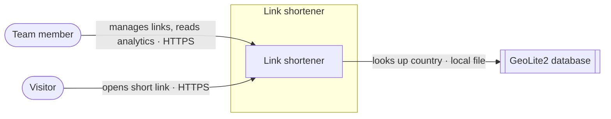
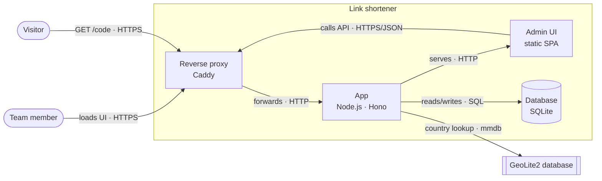
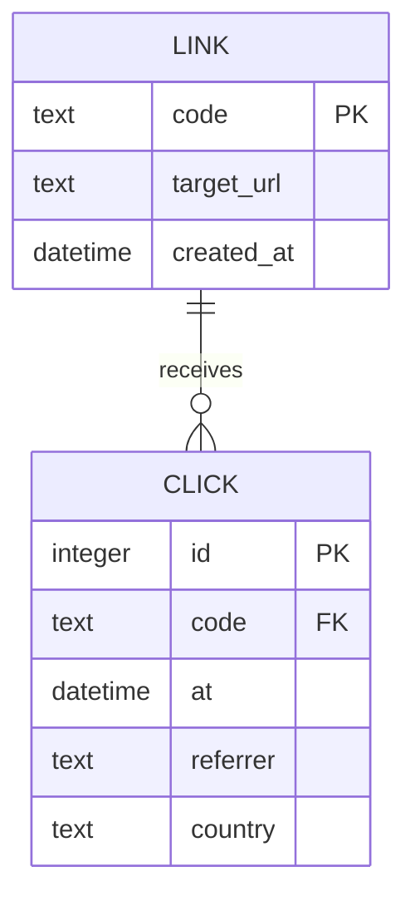
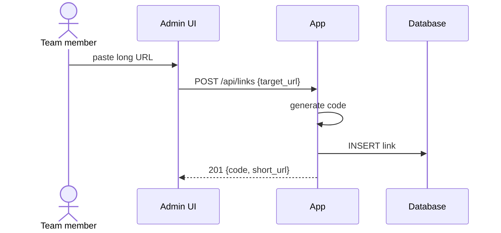
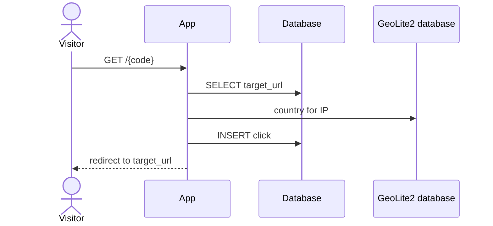
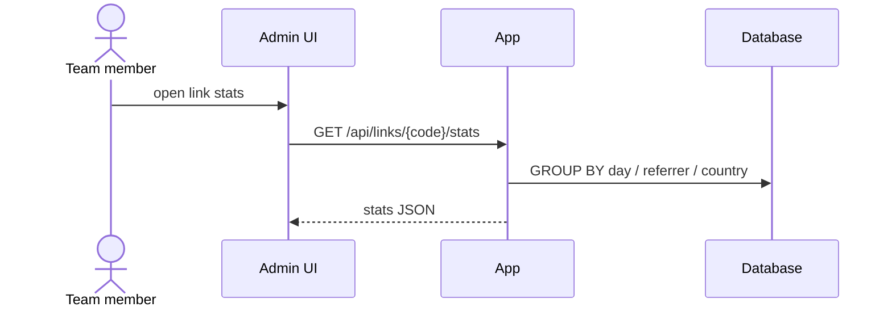

# Self-hosted link shortener

## Goal

A link shortener for a small team, self-hosted on our own VPS, that turns long URLs into short `go.example.com/<code>` links and shows how each link is used, without sending visitor data to a third party.

Success criteria:

- [ ] A team member creates a short link from the web UI or the API in under 1 s.
- [ ] Visiting a short link redirects with server-side latency p95 < 50 ms at 50 req/s.
- [ ] Per-link analytics show clicks per day, top referrers and top countries.
- [ ] The whole system runs on one 2 vCPU / 4 GB VPS with `docker compose up`.

## Non-goals and constraints

**Non-goals:** public sign-up / multi-tenant SaaS, per-user custom domains, link-in-bio pages, real-time dashboards, QR code generation.

**Constraints:**

- One VPS (2 vCPU, 4 GB RAM), Docker Compose, one maintainer.
- TypeScript on Node.js; no paid external services.
- Scale: ~1k links, ~100k redirects/month, peaks of 50 req/s.

## Context

- **Team member**: creates and manages links, reads analytics.
- **Visitor**: anyone opening a short link; never logs in.
- **GeoLite2 database**: MaxMind's free IP-to-country file, read locally, so no visitor data leaves the server.

## Components

| Component | Responsibility | Tech |
| --- | --- | --- |
| Reverse proxy | TLS termination, HTTP→HTTPS, forwards everything to the app | Caddy |
| App | Redirects, link CRUD API, analytics API, serves the admin UI | Node.js, Hono |
| Admin UI | Create/edit links, view analytics | Static SPA served by the app |
| Database | Links and clicks | SQLite file on a Docker volume |

## Data

| Entity | Owner | Store | Notes |
| --- | --- | --- | --- |
| Link | App | SQLite | ~1k rows; `code` is 7 random base62 chars |
| Click | App | SQLite | ~100k rows/month; retention not yet decided |

## Key flows

### Create a link

Proves: create a link in under 1 s.

### Follow a link

Proves: redirect p95 < 50 ms.

### View analytics

Proves: clicks per day, top referrers, top countries.

## Decisions

| # | Decision | Choice | ADR |
| --- | --- | --- | --- |
| 1 | Primary store | SQLite on a volume, single node | [0001](decisions/0001-sqlite-as-the-only-store.md) |
| 2 | Code format | 7 random base62 chars, retry on collision (3.5 × 10¹² space vs ~1k links) | — |
| 3 | Process layout | One app process serves redirects, API and UI; split only if the redirect path needs it | — |
| 4 | Geo lookup | Local GeoLite2 file, keeps visitor IPs on the server | — |

## Open questions and risks

- [ ] **Q1** (blocking) How are clicks recorded without slowing the redirect? The v0 flow inserts synchronously. — _area: analytics_
- [ ] **Q2** (blocking) How do team members authenticate to the UI and API? — _area: auth_
- [ ] **Q3** (major) 301 or 302 redirect? A cached 301 hides repeat clicks from analytics. — _area: analytics_
- [ ] **Q4** (major) What visitor data is stored, and for how long (IP, user agent, raw clicks vs aggregates)? — _area: analytics_
- [ ] **Q5** (minor) How is the SQLite file backed up? — _area: ops_
- [ ] **Q6** (minor) Should members be able to choose custom codes? — _area: links_
- [ ] **R1** (major) Bots and link-preview crawlers inflate click counts. — _area: analytics_ — mitigation: none yet
- [ ] **R2** (major) The shortener is abused to disguise phishing or malware links. — _area: auth_ — mitigation: none yet
