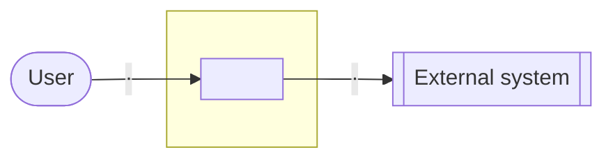
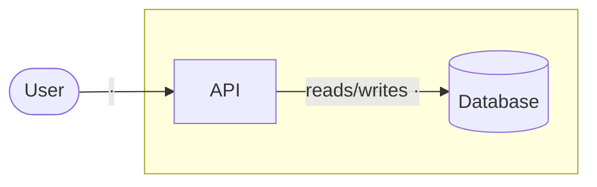
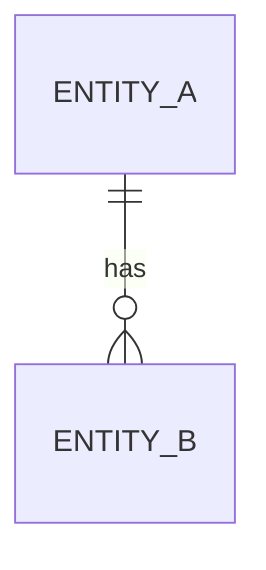
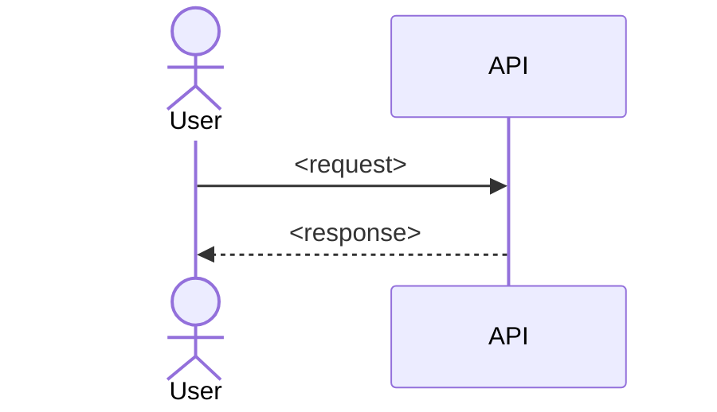

# <Title>

## Goal

<One paragraph: what this achieves and for whom.>

Success criteria:

- [ ] <checkable criterion>
- [ ] <checkable criterion>

## Non-goals and constraints

**Non-goals:** <what this design deliberately leaves out>

**Constraints:**

- <stack / hosting / budget / team / deadline / systems to reuse>

## Current state

<!-- brownfield only: delete for greenfield -->

<Only the parts the goal touches, with file paths.>

## Context

<One line per actor and external system: who/what it is and why it talks to the system.>

## Components

| Component | Responsibility | Tech |
| --- | --- | --- |
| <name> | <one line> | <tech> |

## Data

| Entity | Owner | Store | Notes |
| --- | --- | --- | --- |
| <entity> | <component> | <store> | <key fields, retention, size> |

## Key flows

### <Flow name>

<One line: which success criterion this flow proves.>

## Migration / delta

<!-- brownfield only: delete for greenfield -->

1. <ordered step from current state to target>

## Decisions

| # | Decision | Choice | ADR |
| --- | --- | --- | --- |
| 1 | <what was decided> | <choice and one-line why> | — |

## Open questions and risks

- [ ] **Q1** (major) <question> — _area: <area>_
- [ ] **R1** (major) <risk> — _area: <area>_ — mitigation: none yet
